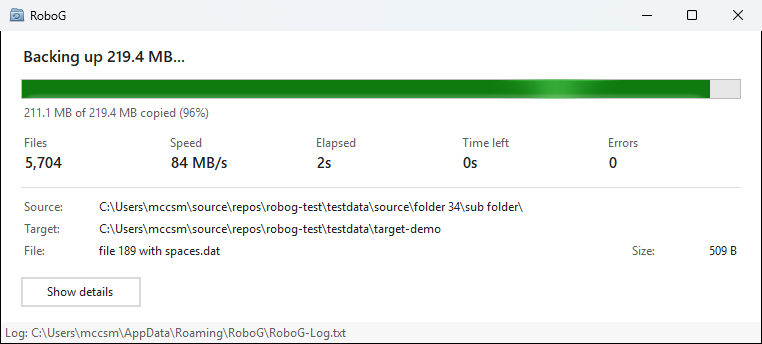
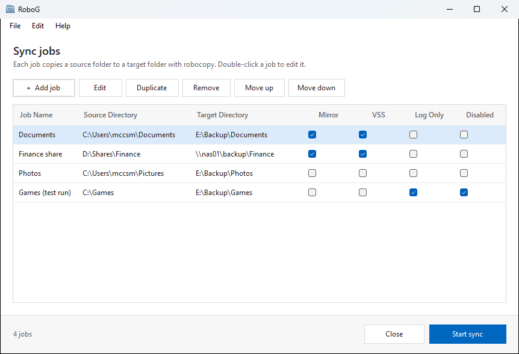
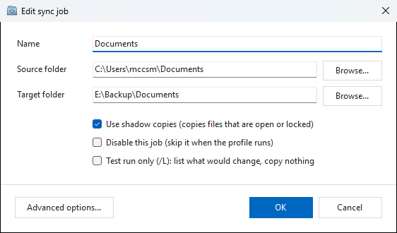
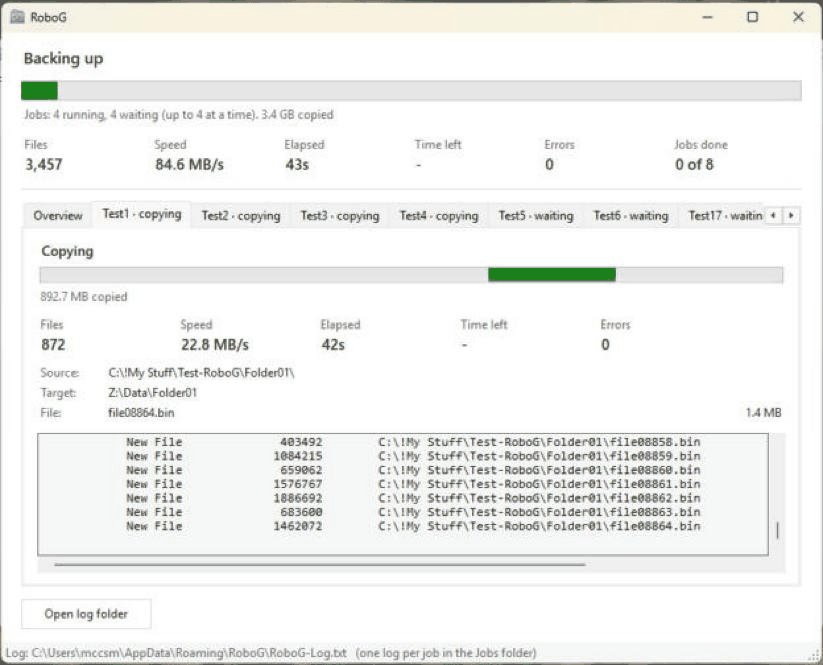
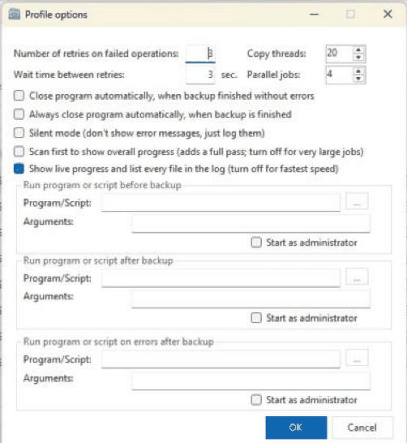
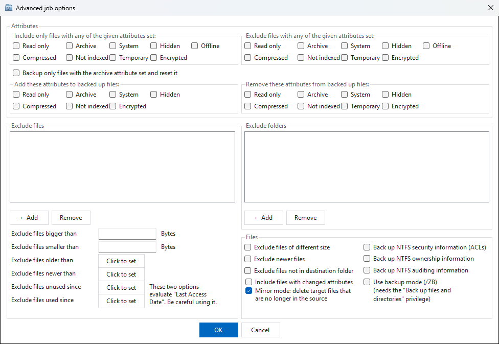

# RoboG

RoboG is a Windows front end for **robocopy**. You define sync jobs (a source folder, a target folder and options), save them as a profile, and run them from the window, a script or a scheduled task. RoboG runs jobs in parallel, shows live progress per job, copies open files through shadow copies, and keeps going when a network share drops out. It is built for large trees, up to billions of files.



## Features

- **Profiles of sync jobs.** Each job has its own source, target, filters and copy options. Profiles are saved as XML files.
- **Parallel jobs.** Several jobs run at once, each with its own robocopy process. Progress for each job is shown on its own tab.
- **Live progress.** Files, MB/s, files per second, time left and errors, for the whole run and per job.
- **Shadow copies (VSS).** Open and locked files are copied as they were at one instant, using the snapshot service built into Windows.
- **Network outage handling.** A job whose share stops answering pauses, then resumes where it stopped once the share is back.
- **Scale.** Memory use doesn't grow with the number of files, and the copy never waits for the screen.
- **Unattended runs.** There are command-line switches, an auto-close option, a silent mode, and programs to run before a sync, after it, and on errors.
- **Languages.** English, German and French.

## Requirements

- Windows 10 or 11. robocopy is included with Windows.
- .NET Framework 4.8, which is included with current versions of Windows 10 and 11.
- Administrator rights, only for shadow copies. RoboG offers to restart elevated when a job needs them.

## Quick start

1. Start RoboG and click **Add job**.
2. Choose a **source folder** and a **target folder**, then give the job a name.
3. Optionally, open **Advanced options** to set filters, mirror mode or security copying.
4. Click **Start sync**.
5. Save the profile with **File > Save Profile**.

## Screenshots

| | |
|---|---|
|  |  |
| **Sync jobs**: the jobs in the profile | **Edit sync job**: source, target, shadow copies, test run |
|  |  |
| **Job tab**: progress, current file and log of one job | **Profile options**: retries, threads, parallel jobs, logging, programs |


**Advanced job options**: attribute filters, excluded files and folders, age and size limits, mirror mode and NTFS security.

## Job options

| Option | robocopy | Notes |
|---|---|---|
| Copy subfolders | `/E` | Default. |
| Mirror mode | `/MIR` | Also deletes files in the target that no longer exist in the source. RoboG asks for confirmation before running. |
| Test run only | `/L` | Lists what would change, copies nothing. |
| Shadow copies | — | Copies from a VSS snapshot. Needs a local NTFS or ReFS source and administrator rights. |
| Exclude files / folders | `/XF` `/XD` | Wildcards allowed. |
| Attribute filters | `/IA` `/XA` `/A+` `/A-` | Include, exclude, add or remove attributes. |
| Archive bit | `/M` | Copy only files with the archive attribute, and reset it. |
| Comparison | `/XC` `/XN` `/XL` `/IT` | Skip files of different size, newer files, or files not yet in the target; include files whose attributes changed. |
| Age and size limits | `/MAXAGE` `/MINAGE` `/MAXLAD` `/MINLAD` `/MAX` `/MIN` | |
| NTFS security, owner, auditing | `/COPY:S` `O` `U` | |
| Backup mode | `/ZB` | Needs the "Back up files and directories" privilege. |
| Disable job | — | The job is skipped when the profile runs. |

**Mirror**, **VSS**, **Log only** (test run) and **Disabled** can also be switched on and off directly in the jobs list: click the box, or press Space on it. Turning on VSS checks the source drive the same way the job dialog does.

**View command...** at the bottom of the progress window shows the exact robocopy command line of the selected job (its tab, or its row on the Overview tab), lists every part of the command with what it does, and copies the command for running by hand.

RoboG always adds `/FFT /DST /XJ /NP /BYTES`. These give 2-second timestamp tolerance (for NAS and FAT targets), allow for daylight-saving changes, skip junctions, and suppress per-file percentages.

## Profile options (Edit > Profile Options)

| Option | Default | Notes |
|---|---|---|
| Retries / wait time | 3 / 3 s | `/R` `/W`. Applies to problems with individual files, such as locked files or access denied. Network outages are handled separately (see below), so these can stay low. |
| Copy threads | 16 | `/MT`. This is the total for the whole run, shared by the jobs running at the same time: 16 threads give 1 job 16, 2 jobs 8 each, 4 jobs 4 each. 1 = EFS raw mode (`/EFSRAW`). |
| Parallel jobs | 4 | How many jobs run at once. The rest queue. Jobs whose targets overlap always run one after the other. |
| Scan first | on | A list-only pass gives an exact progress bar and time estimate, but walks the tree twice. Turn it off for very large trees. |
| Show live progress | on | Lists every file. Off (`/NFL /NDL`) is fastest. Totals still appear when each job finishes. |
| Close automatically | off | Close when the run succeeds, or always. |
| Silent mode | off | Errors are logged instead of shown in a dialog. |
| Logs | `%AppData%\RoboG`, keep 30 runs | Where this profile's logs go, and how many runs to keep (0 = all). See [Logs](#logs). |
| Programs | — | Run a program or script before the sync, after it, and after errors. RoboG waits for each to finish. **Before** runs first (before shadow copies); **after** runs when all jobs are done; **on errors** runs after that, only if a job failed or files could not be copied (not when you stop the run). `.exe`, `.cmd`/`.bat` and `.ps1` (run with PowerShell) all work; each runs in its own folder. Both logs are complete and readable when the after and error programs run, for example to mail them. Each program's exit code is written to the run log. Tick **Don't sync if it fails** under the before program to skip the sync when it can't start or exits with a code other than 0 (a drive it mounts isn't there, say); the run then counts as failed. "Start as administrator" needs RoboG to run elevated in unattended runs. |

## Command line and scheduling

```
RoboG.exe /s /Settings:"C:\path\profile.xml" /Auto
```

| Switch | Effect |
|---|---|
| `/s` | Start the profile's sync immediately. |
| `/Settings:<file>` | Profile to load. |
| `/Auto` | Exit when the run is finished. |
| `/User:<name>` | User name used by generated scripts. |

**Edit > Generate Script File** saves a `.cmd` file that runs the current profile this way. Double-click it to run, or use it as a scheduled task's program. RoboG's progress window opens while it runs, and with `/Auto` it closes when the sync is done.

To check a run afterwards, see its log folder (see [Logs](#logs)), or the exit code (Task Scheduler shows it as **Last Run Result**):

| Exit code | Meaning |
|---|---|
| 0 | Everything was copied |
| 1 | Finished with errors, or a job failed (see the error log) |
| 2 | Stopped by the user |
| 4 | Not started: another RoboG was already open (also noted in `RoboG-NotStarted.txt` in the log folder) |

Only one RoboG runs at a time. Close the RoboG window before a scheduled sync is due, or the sync won't start.

To run it on a schedule, create a task in Task Scheduler that runs the `.cmd` file:

- **Run whether user is logged on or not**, as your own account with its password saved, works with nobody signed in. With `/Auto` RoboG never waits for a click: questions and errors go to the log (mirror jobs run without the confirmation), and the exit code says how it went.
- Use network paths (`\\server\share\folder`) in jobs, not mapped drive letters: a drive like `Z:` exists only in a signed-in session. The task's account must be able to open the share.
- If any job uses shadow copies, tick **Run with highest privileges**.

## How it behaves

**Parallel jobs.** Each job runs its own robocopy. If one job fails, the others carry on, and failures are listed together at the end. Stopping the run stops all running jobs and doesn't start the waiting ones. Shadow copies, and the programs before and after the sync, run once for the whole run.

**Network outages.** When a job gets a network error, RoboG checks whether its source and target are still reachable. If one isn't, it stops that job's robocopy and shows **Waiting for connection**. It checks every 30 seconds and resumes when the share is back; robocopy skips files already copied. Jobs that start during an outage wait instead of failing. File errors caused by the outage aren't counted. If the connection doesn't return within 60 minutes, the job fails with the reason.

**Shadow copies.** All source volumes are snapshotted at the same instant. Job logs and the error log show your own paths (`C:\Users\...`), not the snapshot's. The snapshots are temporary and are deleted when the run ends, even if RoboG crashes. RoboG declares a *copy* backup, so applications such as SQL Server or Exchange don't treat the sync as their own backup. If Windows discards a snapshot mid-run (shadow storage full), RoboG reports it.

A shadow copy gets past *locked* files, not *permissions*. Some folders can't be read even by administrators, such as `C:\Windows\CSC` (Offline Files). robocopy retries those, waiting each time, which shows as pauses at 0 B/s. Turn on **Backup mode** (`/ZB`) in the job's Advanced options to read them anyway, or exclude them. RoboG writes a hint to the log the first time a job gets access denied.

**Stopping a run.** Files robocopy was still retrying when you stopped the run are listed in the error log, marked as such.

**Missing targets.** Target folders that don't exist are created, including every missing parent folder.

## Logs

Each run writes its logs to a folder of its own, so a run never overwrites an earlier one (last night's scheduled sync is still there in the morning):

```
<log folder>\Logs\2026-10-22 02-00-03\
```

If the log folder you choose is itself named `Logs`, the run folders go directly in it.

The log folder is set per profile in **Profile options > Logs** (default `%AppData%\RoboG`; a network share works too). RoboG keeps the newest 30 runs by default and deletes older run folders; set it to 0 to keep all. If the log folder can't be reached when a run starts, that run logs to `%AppData%\RoboG` instead and says so in its run log. **Open log folder** in the progress window opens the current run's folder.

| File | Contents |
|---|---|
| `RoboG-Log.txt` | The run as a whole: shadow copies, and when each job starts and ends. |
| `Jobs\Job-NN-<name>.txt` | Everything robocopy reported for one job. |
| `RoboG-Errors.txt` | Every file that could not be copied, from all jobs, tagged with the job name. |
| `RoboG-NotStarted.txt` | In the log folder itself: scheduled or scripted syncs that didn't start because another RoboG was open. |

Logs are written to disk as the run goes; only the last 500 lines of each are kept in memory. **Show errors** in the progress window lists up to 10,000 errors; the error log file has all of them.

## Performance

For large files, speed is limited by the disks and the network. For small files, the limit is how many files the target can create per second: each file costs several round trips to the target (create, write, set times, close), whatever its size. Watch **Files/s** rather than MB/s when copying many small files.

**Settings**
- Turn off **Scan first** and **Show live progress** for very large runs. With live progress on, every copied file adds a line of about 100 bytes to the job's log (about 100 MB per million files, 100 GB for a billion). With it off, the job log stays small. robocopy's own progress reaches RoboG through a pipe in memory, so it uses no disk space either way.
- Several jobs writing to one NAS with hard disks: total copy threads around 8–16, and fewer parallel jobs.
- Jobs on different disks or servers: more parallel jobs.

**Samba (Linux) targets**
- **Folders with many files.** Samba reads the whole folder before creating each file, to check for names that differ only in capitals. With tens of thousands of files per folder, this caps the copy rate. In testing, folders of 125,000 files went from about 60 to about 250 files/s after adding this line to the share's section of `smb.conf`:
  ```
  case sensitive = yes
  ```
  Names are still stored as copied. The difference is that lookups must use the exact capitals, which robocopy always does.
- **Diagnosing.** One `smbd` process at 100% of a core in `top` means Samba is the limit. `strace -c -p <smbd pid>` will show which calls dominate: thousands of `getdents64` calls are folder scans, and one `fsync` per file means each file is being forced to disk.
- **Samba in a VM.** Use virtio disk and network devices, disk cache mode `none`, and 2 GB of memory or more.
- **Filesystem.** XFS creates inodes as needed. ext4 fixes the inode count (the maximum number of files) when the filesystem is created, so check `df -i` before very large tests.

**Tested:** 8 parallel jobs over 2.5 GbE to a Samba server on XFS, at about 250 MB/s with ~1 MB files.

## Building

1. Install Visual Studio 2022 or later (Community is fine) with the **.NET desktop development** workload.
2. Open `RoboG.sln`, select **Release** / **Any CPU**, and build. The program is written to `bin\Release`.

Keep the platform on **Any CPU**, because a 32-bit process cannot create shadow copies on 64-bit Windows. There are no third-party dependencies.

## Donate

If this project helps you be more productive, you can buy me a cup of coffee :)

**[☕ Buy me a coffee](https://buy.stripe.com/9B66oz39Y2Hqeu02eX2Fa00)**: choose any amount on the secure Stripe page.

## License

Released under the GNU General Public License, version 3 or later. See [LICENSE](LICENSE).
